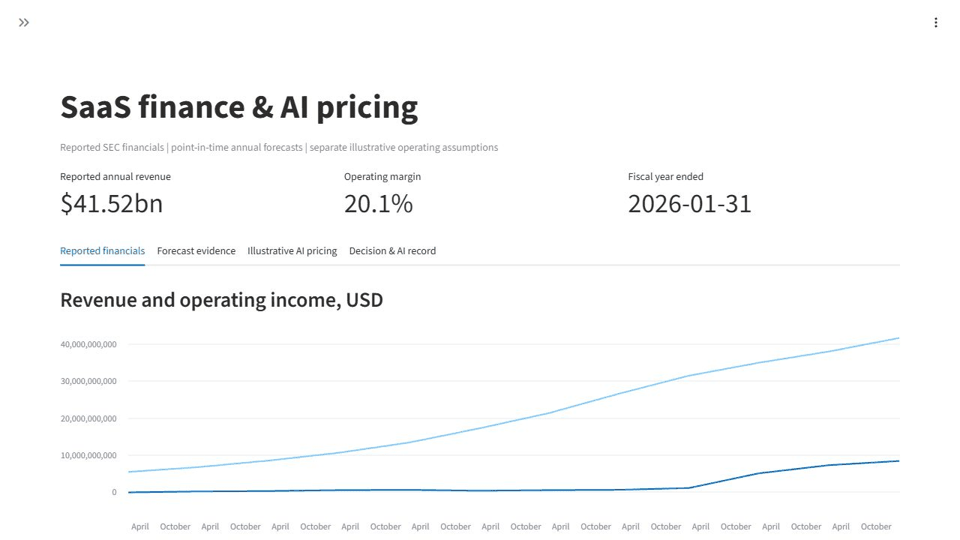

# SaaS Finance Intelligence

**The apparent $10k/month metering advantage vanished at equal prices.**

[Live dashboard](https://dineshsatti90-saas-finance.streamlit.app/) · [Two-minute walkthrough](docs/WALKTHROUGH.md) · [Excel model](outputs/saas-finance/saas_financial_planning.xlsx) · [Run & methodology](docs/PROJECT_GUIDE.md)

- **Forecast evidence:** 3.99% driver-model WAPE versus 4.44% trailing growth on 40 point-in-time paired targets.
- **Equal-price economics:** both policies contribute $8k/month at the illustrative baseline.
- **Risk allocation:** assumed heavy users consume 46.8% of requests; 64 scenarios vary adoption under both policies, with a separate light-user exit case.

### AI: source selection with measured limits

| Model | Raw reference/coverage pass | Unsupported refusal |
| --- | ---: | ---: |
| qwen2.5:3b | 44.4% | 0.0% |
| llama3:8b | 52.8% | 11.1% |

36 cases: 20 reused and 16 first-pass v2. The demo shows saved verified output; experimental free-form routing has refusal failures. [Both models, policy replay and failure cases](docs/AI_EVALUATION.md).

**Excel · SQL · Python · DuckDB · Streamlit**

[Pricing decision](reports/pricing_decision.md) · [SEC source trail](reports/annual_facts.csv) · [Tests](tests) · [Native Excel checks](outputs/saas-finance/native_excel_verification.json) · [Method choices](docs/METHOD_CHOICES.md) · [Limits](docs/PROJECT_GUIDE.md#limitations)
