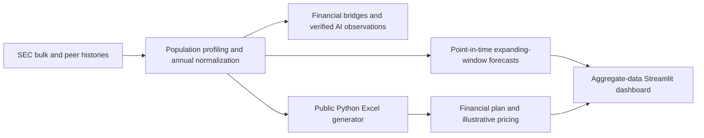

# SaaS Finance Intelligence

[](https://github.com/Dineshsatti90/saas-finance-intelligence/actions/workflows/check.yml)

**What financial plan—and AI feature price—can the evidence support?**

Real SEC financials, expanding-window forecast evaluation and a populated Excel planning model. Reported company results and illustrative operating assumptions remain separate.

**Dashboard:** `streamlit run app.py` — runs on committed aggregates without a warehouse download.

**[Download Excel model](outputs/saas-finance/saas_financial_planning.xlsx)** · [Pricing decision](reports/pricing_decision.md) · [Financial source trail](reports/annual_facts.csv)

## Three findings

1. **A modest driver model improves this paired benchmark:** WAPE is 3.99%, versus 4.44% for trailing growth and 14.23% for flat revenue on the same 40 annual targets. Training uses only labels public at each origin.
2. **Metered pricing is the better test hypothesis in the illustrative case:** $0.015/request contributes $18,000/month versus $8,000 for a $25 add-on. The add-on breaks even at $21/account/month under the specified usage and cost assumptions.
3. **Bundling needs evidence:** covering its $42,000 monthly cost requires about 541 extra accounts retained for a full year—5.41 percentage points of annual churn improvement across the assumed 10,000-account base—in the simplified retention model.


**Stack:** Python · SQL · DuckDB · scikit-learn · XlsxWriter · Excel · Streamlit · optional local/API LLM.

## Reported data and operating assumptions

The warehouse ingests **3,832,977 SEC numeric records** from the full 2025 Q4 release and **171,654 company-fact observations across eight peers**. Salesforce FY26 revenue is $41.525bn; its gross-profit increase is $3.003bn. Period ends, tags, accessions and filed dates remain in the normalized outputs.

The workbook uses real Salesforce annual actuals and editable forward rates. Separate **IllustrativeCo** ARR, staffing and AI schedules are populated fictional operating assumptions, with core gross margin calibrated to a reported value. A prominent cash warning distinguishes pre-financing accumulation from a cash balance forecast.

## Run or rebuild

```bash
python -m venv .venv
# Windows: .venv/Scripts/Activate.ps1
# macOS/Linux: source .venv/bin/activate
python -m pip install -r requirements.txt
streamlit run app.py
```

The demo reads committed extracts. Rebuild the workbook with public Python libraries only:

```bash
python build_workbook.py
python -m pytest tests -q
# Optional blank operating template, preserving reported actuals:
python build_workbook.py --blank --output blank_operating_template.xlsx
```

For a full refresh, set `SEC_USER_AGENT` to a project name and real contact, then run `fetch.py`, `model.py --asof 2026-11-26`, `planning.py`, `forecast_study.py`, `pricing_case.py` and `build_workbook.py`. [Detailed operations](docs/OPERATIONS.md).

## Excel and AI validation

The workbook was recalculated in **Microsoft Excel 16.0**. Verification exercised Base/Downside switching, a later-year assumption and a zero-adopter boundary, then restored and saved the original inputs. [Native verification](outputs/saas-finance/native_excel_verification.json). CI rebuilds the workbook using XlsxWriter and tests source ties, formula caches and blank-input behavior. Committed AppTests exercise company selection and pricing changes.

Local Qwen 2.5 3B passed **100% of 10 disclosed historical bridge cases** under a narrow numeric/source-key contract. [Raw and verified outputs](reports/ai_evaluation.json) · [Salesforce example](reports/ai_commentary.json) · [Evaluation protocol](docs/AI_EVALUATION.md).

## Architecture and documentation



- [Data dictionary](docs/DATA_DICTIONARY.md), [methodology](docs/METHODOLOGY.md), [operations](docs/OPERATIONS.md)
- [Driver model comparison](reports/driver_backtest_summary.json) and [each forecast](reports/driver_backtest.csv)
- [Illustrative inputs](inputs/illustrative_case.json), [pricing calculations](reports/pricing_case.json) and [decision](reports/pricing_decision.md)
- [Power BI measures](bi/measures.dax), [MIT code license](LICENSE) and [source terms](DATA_LICENSE.md)

## Limitations

Eight peers and annual observations form a small selected panel; 40 paired targets do not establish production monthly accuracy. Predictors and training labels are point-in-time, while scoring uses restated outcomes at the cutoff. The ridge penalty is fixed, not test-tuned. GAAP revenue is not ARR; external forecasts are not internal budgets. Fictional operating inputs are not issuer disclosures or current provider quotations. Demand elasticity and retention benefits are unobserved. Cash accumulation excludes financing, acquisitions, investments, repurchases and FX. Missing inputs in the optional blank template yield `n.a.`. AI contract checks do not establish narrative completeness. Source refreshes may change comparative vintages. Native Power BI `.pbix` is not included.
