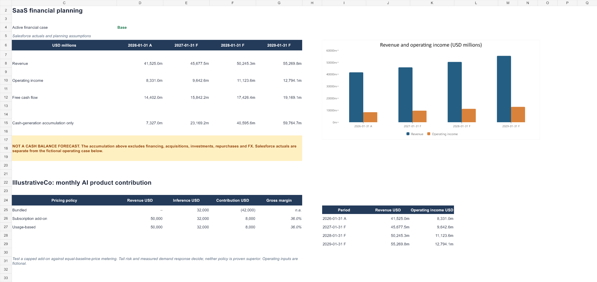
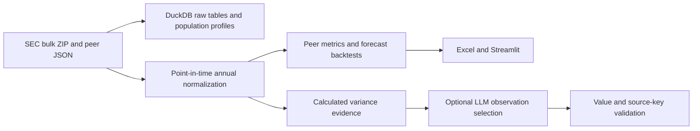

# SaaS Finance Intelligence

Corporate-finance case study combining real SEC financials, point-in-time forecast evaluation, an editable Excel planning model and explicitly assumed AI product economics.

**Business question:** what growth/spending plan can reported SaaS financials support, and under what explicit assumptions could an AI add-on make a positive contribution?

**Stack:** Python · SQL · DuckDB · Excel formulas · Streamlit · Power BI exports · optional OpenAI-compatible LLM.

## Results at a glance

| Measure | Reference result | Scope |
| --- | ---: | --- |
| SEC numeric records ingested | 3,832,977 | Complete 2025 Q4 numeric release |
| Company-fact observations loaded | 171,654 | Eight software peers; not customer records |
| Historical forecast targets | 58 | Same annual targets evaluated under both methods |
| Flat-revenue forecast WAPE | 15.00% | Out-of-sample annual external forecast |
| Trailing-growth forecast WAPE | 4.16% | Filings available at each forecast origin only |
| Salesforce annual revenue | $41.525bn | Fiscal year ended 31 January 2026 |
| Salesforce gross-profit change | +$3.003bn | Versus prior fiscal year; arithmetic bridge |

**Decision:** use the driver-based model to compare growth and spending cases, and establish an AI feature's contribution break-even before choosing a pricing policy. Public financials support historical calibration; operational ARR, staffing and AI bills require additional business inputs.

Real SEC historical financials, point-in-time annual forecast evaluation, an editable formula-driven Excel model, pricing assumptions and source-linked AI observations. [Decision memo](reports/decision_memo.md), [source manifest](reports/source_manifest.json), [forecast errors](reports/backtest_summary.json).



## Data scale and relevance

- Full **2025 Q4 SEC Financial Statement Data Set**: millions of numeric XBRL records, plus submissions, tags and presentation records. All records are ingested; full-population filing coverage and annual-revenue extracts are generated using SQL.
- Complete company-facts JSON files for Salesforce, ServiceNow, Adobe, Intuit, Workday, Atlassian, HubSpot and Snowflake. These are software peers, not identical business models.
- Comparable annual USD financial metrics are normalized separately. A million XBRL facts is not a million customers or a million SaaS annual statements.
- Analysis cutoff defaults to **2026-11-26**. `--asof YYYY-MM-DD` changes it reproducibly. The fixed bulk release supports population profiling; company-facts files supply subsequent annual histories. Download timestamps and SHA256 hashes identify source vintages.

Sources: [SEC quarterly datasets](https://www.sec.gov/dera/data/financial-statement-data-sets.html), [SEC XBRL APIs](https://www.sec.gov/search-filings/edgar-application-programming-interfaces). Filing URLs, accession numbers, tags and publication dates accompany normalized facts. Respect SEC fair access; set `SEC_USER_AGENT` to your portfolio name and real contact before refreshing (the example default is only an example contact). Downloads are sequential and cached; no authentication is needed.

## Quick start

```powershell
python -m venv .venv
.venv/Scripts/Activate.ps1
python -m pip install -r requirements.txt
$env:SEC_USER_AGENT = 'YourPortfolio your-real-contact-email'
python fetch.py
python model.py --asof 2026-11-26
python planning.py
python -m pytest tests -q
streamlit run app.py
```

Run from the repository root. On macOS/Linux use `source .venv/bin/activate` and `export SEC_USER_AGENT='YourPortfolio your-real-contact-email'`. The first run downloads a full SEC release plus eight peer files. After ingestion, the dashboard and checked-in Excel model can be reviewed without an LLM key. `requirements.lock.txt` records tested top-level runtime versions; it is not a complete transitive lockfile.

The checked-in workbook is under `outputs/saas-finance/`. To regenerate it, install `@oai/artifact-tool` in an authoring environment, then run `node build_workbook.mjs`. The authoring dependency is separate from the Python dashboard; all runtime data is produced by the commands above. The generated workbook keeps ordinary Excel formulas and does not require Node to use.

## Financial definitions and controls

- Annual revenue is GAAP revenue, **not ARR**. USD flow metrics require a 300–380 day duration and a 10-K; point-in-time cash is treated separately. Fiscal period ends remain explicit. Quarterly YTD flows are not mistaken for standalone quarters.
- Latest available filing vintage at a chosen cutoff is selected per metric/period, then preferred tag. Tag mappings are explicit, missing values stay missing and original source records remain unchanged. Custom-company tags are not silently guessed; unavailable peer metrics should be reviewed against the filing before extension.
- Gross profit bridge = revenue change × prior gross margin + current revenue × margin change. This reconciles exactly but does not prove causal drivers.
- Annual forecast backtests use only filings available at each origin. Report flat-revenue and trailing-growth errors, including failures. Targets use restated actuals available at the analysis cutoff; the test is annual and small, not evidence of production monthly forecast performance.
- The forward forecast is an external planning case, **not internal budget or management guidance**. Costs, operating expenses and cash conversion are distinct. Cash scenario excludes financing, acquisitions, investment trading, repurchases and FX.

## Real data versus unavailable operating inputs

Historical financials and peer comparisons are real. Public filings do not disclose a full customer-level ARR roll-forward, internal headcount plan, paid-FTE cost schedule, internal budget or AI inference bill. The Excel ARR/headcount schedules therefore start blank and return `n.a.` until user inputs are supplied. No synthetic historical SaaS operating dataset is used.

AI pricing inputs are explicit assumptions: accounts, adoption, request volume, tokens, USD/million-token rates, fixed incremental spend and candidate prices. No price from a model provider is hardcoded as a current market quote. Bundling has zero incremental feature revenue in this calculation, so its feature gross margin is undefined, not 100%; retention and cross-sell benefits are outside this model.

## AI reporting integration and evaluation status

Set `LLM_BASE_URL`, `LLM_MODEL` and `LLM_API_KEY` as needed; run `python planning.py --llm`. An OpenAI-compatible JSON-mode endpoint selects material calculated observations. The verifier rejects altered numbers, unknown metrics and free-form explanations. The renderer attaches exact JSON metric citations. Without a configured model, `ai_commentary.json` records **not run**. No accuracy score is invented. Unit tests challenge arithmetic, fabricated causes and citation-key validity; a human must still assess relevance and completeness.

## Deliverables

- Runnable Streamlit dashboard: financial history, forecast errors, pricing calculator, verified observations.
- Excel model: real actuals, active scenario selector, live multi-year forecast, blank ARR/headcount inputs, AI pricing comparison and reconciliation checks.
- SQL-backed population profiling and normalized CSVs with source links.
- Power BI-ready exports and `bi/measures.dax`; native `.pbix` is not included.
- Decision memo, data manifests and regression tests. No Buy/Sell rating or claimed realized savings.

## Repository guide

| Location | Purpose |
| --- | --- |
| `fetch.py` | Cached sequential SEC downloads and SHA256 source manifest |
| `model.py` | Raw population profiling, annual normalization, peer metrics and point-in-time backtesting |
| `planning.py` | Scenario calculations, gross-profit bridge, AI pricing economics and verified observations |
| `app.py` | Financial analysis and pricing dashboard |
| `build_workbook.mjs` | Excel authoring source; requires the separately supplied artifact-tool runtime |
| `outputs/saas-finance/` | Editable workbook, seven previews and calculation-verification record |
| `reports/` | Financial extracts, filing-level citations, forecast errors and decision memo |
| `bi/` | Power BI starter measures |
| `tests/` | Reconciliation, token units, claim verification and point-in-time checks |

## Validation

The reference run passed **4 Python regression tests**, including a point-in-time check against real downloaded Salesforce facts. Streamlit AppTest exercised company selection. The Excel authoring engine checked base/downside switching, a later-period assumption, missing selected versus unselected inputs, agreement with Python and a formula-error scan. All seven sheets were visually reviewed. Native Microsoft Excel recalculation has not been exercised.

CI runs the Python suite; the real-data integration check explicitly skips when raw data is absent. No LLM accuracy is claimed: generated commentary remains **not run** until a compatible model is configured. Numeric/source validation is a contract test, not proof of narrative completeness.

## Documentation

- [Financial data dictionary](docs/DATA_DICTIONARY.md)
- [Forecast methodology and financial-model boundaries](docs/METHODOLOGY.md)
- [Reproduction, model use and troubleshooting](docs/OPERATIONS.md)
- [Decision memo](reports/decision_memo.md)
- [Source and licensing notes](DATA_LICENSE.md)
- [Contribution guide](CONTRIBUTING.md)

## Architecture


